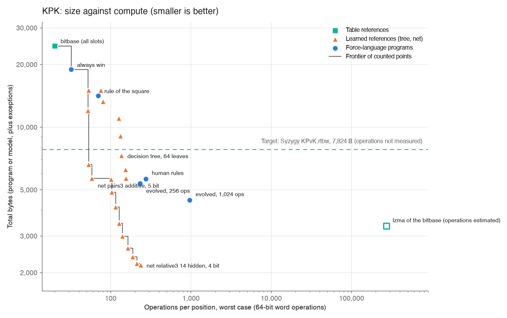

# Beginner's guide

This page explains the project in plain words. No chess or computer science knowledge is needed. The technical details are in [STATUS.md](STATUS.md), [01](01-dsl-concept.md) and [02](02-agent-loop.md). Words in *italics* are in the glossary at the end.

## The idea in one minute

Chess endgames with few pieces are completely solved. For every position the true result is known: a win or a draw. The answers are stored in large files called *tablebases*. We want to know: can a short set of rules replace the big file? Not "almost", but exactly, including a list of every exception.

The goal is not to play chess well. It is to find out how short a correct description can be. A short description that works on many positions is what we call understanding; a huge list of answers is just memory.

The yardstick is *Syzygy*, the standard tablebase format. A program plus its list of mistakes must be smaller than the Syzygy file of the endgame, and it must still answer each position quickly. Small endgames are only practice: the interesting ones have five pieces or more, where Syzygy files are megabytes.

## The example we work on: KPK

KPK means: White has a king and one pawn, Black has only a king. White wants to bring the pawn to the last rank, where it becomes a queen. Black tries to stop that. If both play perfectly, White either wins or the game is a draw.

There are 165,676 different positions in our table (the pawn stands on the left half of the board, because the right half is the mirror image). Two thirds are wins for White, one third are draws.

We made this table ourselves and compared every single position with a tablebase that other people made. Both agree.

## A first rule

Here is an old chess rule, "the rule of the square": if the black king is too far away from the pawn's goal, it cannot catch the pawn, and White wins. In our language it is three lines long.

It is right in 99.3% of the positions where it says "White wins", but it finds only 73.5% of the wins. It gets 30,006 of 165,676 positions wrong. So it is a good idea, but not the whole truth.

## How we measure

Imagine you must send a friend all 165,676 answers. You may send:

1. a **short program** that calculates most answers, and
2. a **list of mistakes** that the program makes.

The friend then knows everything exactly. The total length of both parts is the score, counted in bytes. Smaller is better. One byte is eight yes/no bits. The rule of the square needs 16 bytes for the program and 14,135 bytes for the list of mistakes, together 14,151.

## Three numbers: stored, steps, held

Length alone is not enough. Think of a suitcase, a walk, and a table to work on.

| Number | Picture | Meaning |
| --- | --- | --- |
| **Bytes stored** | the packed suitcase | Everything you must send: the program (or net, or table) plus the list of mistakes. This is the "total length" above. |
| **Steps** | the walk to one answer | Simple machine steps (an addition, a comparison, reading one number) needed for one position. We report the worst case. |
| **Bytes held** | the table you unpack the suitcase on | What must be unpacked and kept in memory before the first answer. Data that can be read directly from its stored form does not count. |

All three matter, because each one alone can be cheated:

- Only *stored*: a tiny program that replays all possible games is very short, but needs an enormous number of steps.
- Only *steps*: a plain list of all answers needs 20 steps, but 24,576 bytes stored.
- Without *held*: a compressed list is only 3,341 bytes stored, and once it is unpacked an answer takes 20 steps. But unpacked it is the plain list again, 24,576 bytes on the table. That is memory, not understanding.

The same methods, with all three numbers:

| Method | Bytes stored | Steps (worst case) | Bytes held |
| --- | ---: | ---: | ---: |
| Plain list of answers | 24,576 | 20 | 0 (read directly) |
| Compressed list (lzma), unpacked once | 3,341 | 20 | 24,576 |
| Best small neural network | 2,178 | 235 | 7,534 |
| Best program the AI found (fast) | 5,367 | 232 | about 470 |
| Human rules | 5,639 | 273 | about 250 |
| Rule of the square | 14,151 | 70 | about 50 |

How we count *held*: a net holds one byte for each of its numbers; a program holds about 2 bytes for each of its building blocks (the fast program has 234). The list of mistakes is not counted as held, because single entries can be looked up in the packed list; we charge 32 steps for that. Both are choices, not laws of nature.

How much may be held? The plan (not built yet): no single fixed limit. A hard limit could throw away a good solution that is one byte too large, so results will be shown at several limits, with near misses listed next to them, and programs over a limit will be kept and looked at again. Which limit is used matters: with little memory allowed our programs look better, with more memory the neural networks do.

A program may use at most 4,096 steps per position. For comparisons with other methods there are four speed classes: 64, 256, 1,024 and 4,096 steps.

## The language

Programs are written in a small language, the *DSL*. It knows squares, sets of squares ("fields"), attacks and distances. It cannot play moves, read a table or store data. That is on purpose: a program should say something about the position, not look up the answer.

Example, the rule of the square:

```python
def wins() -> Bool:
    n = min(5, 7 - rank(P))
    return K not in path(strong, P) and n + 1 - tempo < dist(k, sq(file(P), 7))
```

In words: the pawn needs n moves. The white king must not stand in the pawn's way, and the black king must be further than n moves from the goal square. `tempo` is 1 if White moves next, else 0.

## What we did

1. Built the table of true answers.
2. Built the language, the checker that counts steps, and the score.
3. Built other methods as references: a compressed table, decision trees and small neural networks. Wrote rules by hand.
4. Let an AI (Claude Haiku) write programs. A computer checked each one against all 165,676 positions and kept the good ones. This ran once, with 1,076 attempts.

## What came out so far



Every dot is a method. Lower and further left is better: less total length and less work. Blue circles are programs in our language, orange triangles are learned methods, green squares are tables. The dashed line is the Syzygy file, the target.

As of 2026-11-26 (current numbers: [endgames/kpk/report.md](../endgames/kpk/report.md)):

- Three programs in our language are smaller than the Syzygy file for KPK (7,824 bytes). The best one, found by the AI, needs 4,459 bytes and at most 959 steps; the hand-written rules need 5,639 bytes.
- That is a weak test. KPK is so small that a compressed table (3,341 bytes) and a small neural network (2,178 bytes) are smaller still. They are shown as references: they tell how much of a win comes from the ideas in a program and how much from the endgame being easy.
- Two cautions. Our sizes are computed as the shortest possible encoding, while Syzygy's is a real file, so a real file of ours would be somewhat larger. And Syzygy's steps were not counted.
- The ideas the programs use are known chess: the rule of the square, opposition, key squares, the rook-pawn corner.
- An earlier statement that the AI had beaten the neural networks was wrong, because the networks we compared with were too weak.

## What we do not know yet

- Do programs stay smaller than Syzygy in endgames with five pieces and more, where the files are megabytes? This is the real question. Not tested.
- Is the win in KPK more than the format? Syzygy's file is built for every endgame alike; the references show that KPK alone can be packed much smaller.
- Do ideas found in one endgame help in the next one? This is called *transfer*. Not tested.
- Does the AI find something new, rather than known chess ideas? Not so far.

## Try it yourself

This costs nothing:

```text
uv sync
uv run chess-forces score endgames/kpk/programs/square.dsl
uv run chess-forces report
```

The search with an AI (`evolve`) costs money and needs an API key; it stops by itself at the limit you give.

## Glossary

| Word | Meaning |
| --- | --- |
| API, API key | The door through which programs talk to Claude. The key is the password; it is never stored in the code. |
| Bitbase | A list with one yes/no bit for every position. |
| Baseline, reference | Another method shown for comparison, not as a target: tables, decision trees, neural networks. |
| Bytes held | What must be unpacked and kept in memory before the first answer. Data that can be read directly from its stored form does not count. |
| Bytes stored | Everything that must be kept or sent: program (or net, or table) plus the list of mistakes. The score. |
| Byte, bit | A bit is one yes/no. Eight bits are one byte. We measure length in bytes. |
| Castling, en passant | Special chess moves. They do not matter in KPK. |
| Decision tree | A set of yes/no questions, one after the other, that leads to an answer. |
| DSL | Domain-specific language: a small language made for one purpose. Ours is for rules about positions. |
| Effort | How long Claude thinks before answering. More costs more. |
| Endgame | The last phase of a chess game, with few pieces. |
| Error groups | Wrong answers sorted by kind, so we see where a program fails. |
| Exception | A position the program gets wrong. It has to be listed. |
| Exception list | The list of those positions. Its length is part of the score. |
| Field | A set of squares, for example all squares a king attacks. |
| Fingerprint | A short code that changes if the language changes. It protects old results. |
| Force program | A program in our language. |
| FunSearch | A published method: an AI proposes programs, a computer checks them, good ones are shown to the AI again. |
| Hash | A short code for a large amount of data. Equal data gives equal hashes; used to check that a table is correct. |
| Island | A separate group of programs that develops on its own, for variety. Here each island has a speed limit. |
| King, queen, pawn, rook | Chess pieces. The king moves one square, the queen moves far in all directions, the rook moves in straight lines, the pawn moves forward one square at a time and becomes a queen on the last rank. |
| KPK, KQKP | Short names for endgames: the letters say which pieces are on the board. KPK: king and pawn against king. KQKP: king and queen against king and pawn. |
| Key square | A square that decides the game if the king reaches it. |
| Opposition | When the kings face each other with one square between. The player who must move is often at a disadvantage. |
| Decode, unpack | Turning a packed form back into a usable one, for example opening a compressed file. |
| Operation, step | One small machine step, for example an addition or reading one number. We count them instead of time, because time depends on the computer. |
| Pareto frontier | The set of best compromises: for each point on it, nothing else is both shorter and faster. |
| Position | Where all pieces stand and who moves next. |
| Primitive | A building block of the language, for example "distance between two squares". |
| Program | Text in our language that decides "White wins" or not. |
| Prompt | The text we send to the AI. |
| Promotion | A pawn reaching the last rank becomes a queen (or another piece). |
| Proposal | One program the AI suggests. |
| Quantisation | Storing numbers with only a few possible values, so they take less space. |
| Resume, abort | The loop stops at a money limit, and starts again later at the same place. |
| Rook pawn | A pawn on the edge of the board. Often a draw, because the defending king can hide in the corner. |
| Rule of the square | If the defending king cannot enter an imaginary square around the pawn's path, it cannot catch the pawn. |
| Search run | One session in which an AI makes many proposals. The first is called r1. |
| Seed | A starting program (or a starting number for random choices, so a run can be repeated). |
| Size (of a program) | The length of the program counted in bits, if every choice in it is written as briefly as possible. |
| Stalemate | A side has no legal move, but is not in check. The game is a draw. |
| Strong side, weak side | The side with the extra piece, and the other side. |
| Syzygy | The standard public collection of tablebases. The size of its file is the target; we also use it to check our own table. |
| Table net, neural network | A kind of learned calculator: it adds numbers looked up from small tables, and decides from the sum. |
| Tablebase | A file with the exact result of every position of an endgame. |
| Target | The size of the Syzygy file for an endgame. A program plus its list of mistakes must be smaller, within 4,096 steps. |
| Tempo | Whose turn it is. |
| Tier | A class of speed: at most 64, 256, 1,024 or 4,096 steps. Used to compare with references at the same speed. |
| Token | A piece of text (about three quarters of a word). The AI is paid per token. |
| Transfer | Using an idea from one endgame in another one. |
| True result | Win, draw or loss with perfect play by both sides. |
| WDL | Win, draw, loss: the three possible results. |

## How to read the other documents

[STATUS.md](STATUS.md) says what is done and what is next. [01-dsl-concept.md](01-dsl-concept.md) explains the language and the score. [02-agent-loop.md](02-agent-loop.md) explains how the AI searches. [endgames/kpk/report.md](../endgames/kpk/report.md) has all results as a table.
