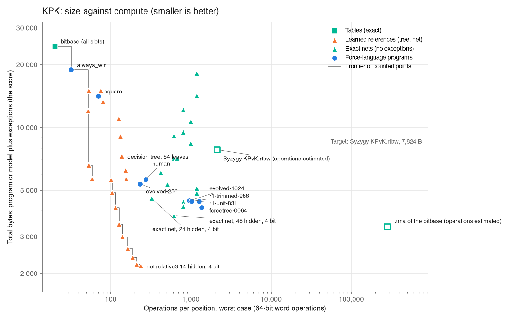

# KPK: analysis

First pass finished on 2026-11-26 and reviewed the same day; the review (last section) reopened KPK. Numbers come from `uv run chess-forces report` (`report.md`, `report.json`, `report.png` in this folder) unless a line names another command. Language dsl 0.2 (fingerprint acd01c74a7d2eb2c), table sha256 03e81336…



## Question

Can a short program in the force language, plus the list of positions it gets wrong, be smaller than Syzygy's `KPvK.rtbw` (7,824 B), with at most 4,096 operations per position? KPK has 165,676 positions with the pawn on files a–d and either side to move; the program answers "White wins" or not, and every position is checked against the table.

## Result

Yes. Six force programs are smaller than the Syzygy file, counted in real bytes, at a comparable number of operations.

| Program | Real bytes | Against Syzygy | Bound (score) | Errors | Operations, mean / max |
| --- | ---: | ---: | ---: | ---: | ---: |
| `forcetree-0064` | 4,480 | −43% | 4,137 | 4,505 | 498 / 1,355 |
| `r1-unit-831` | 4,886 | −38% | 4,426 | 5,363 | 403 / 1,259 |
| `r1-trimmed-966` | 4,890 | −38% | 4,430 | 5,398 | 356 / 1,019 |
| `evolved-1024` | 4,920 | −37% | 4,459 | 5,426 | 361 / 959 |
| `evolved-256` | 5,893 | −25% | 5,367 | 6,977 | 202 / 232 |
| `human` | 6,207 | −21% | 5,639 | 7,590 | 180 / 273 |
| Syzygy `KPvK.rtbw` | 7,824 | | | 0 | about 983 / 2,122 (estimate) |

- **Real bytes** are an actual encoding (`src/chess_forces/codec.py`): the program as one mixed-radix integer over its grammar choices, which the tests decode back to the same tree, plus a 2-byte length, and the exceptions as Elias–Fano with a select sample every 256 zeros, so one position can be looked up without unpacking the rest. The real size is about 10% above the bound (grammar code plus log2 C(N, k)); almost all of the difference is the exception list.
- **Syzygy's operations** are an estimate: `uv run python scripts/syzygy_ops.py` probes every position through python-chess with a counting copy of the decoder and prices each step by hand (`syzygy.json`). In the worst case most of it is Huffman decoding inside a block (97 symbols and 258 length comparisons for one position). The programs' worst cases (959 to 1,259) are below Syzygy's estimated worst case, their means (356 to 403) below half of its mean.
- Both sides leave out their decoder: the DSL interpreter for the programs, the probing code for Syzygy. A listed exception is charged 32 operations to look up, an assumption.

## The references are smaller still

| Reference | Real bytes | Operations, max |
| --- | ---: | ---: |
| table net, relative3, 14 hidden, 4 bit | 2,351 | 235 |
| lzma of the bitbase | 3,341 | about 282,600 (estimate) |
| decision tree, 128 leaves | 6,205 | 155 |
| bitbase, one bit per slot | 24,576 | 20 |

A small net needs half the bytes of the best program at a fifth of its worst case, and a general compressor is smaller too if compute is ignored.

Nets can also be exact. 29 nets from the training sweep answer every position with no exception list; all are kept in `nets/` (retrained from the sweep record, checksums identical) and listed in the report. The smallest, relative3 with 48 hidden units, is 4,018 B real (3,795 B score) at 611 operations; the fastest, relative3 with 24 hidden units, is 4,783 B at 323. Both are smaller than Syzygy. No force program within the language's limits is exact (see the review below for one beyond them). KPK is so small and regular that a learned table of weights fits it well; being smaller than Syzygy here says more about Syzygy's general file format (headers, block index, one format for every endgame) than about the concepts.
## What the programs know

The programs are readable and use textbook ideas: the rule of the square, key squares in front of the pawn, the opposition, the rook-pawn corner, a loose pawn the weak king reaches first, a blockade in front of the pawn, the weak king taking the pawn. `r1-unit-831` is 20 lines; its program part is 156 B, the other 4,270 B (bound) are its 5,363 exceptions. Run r1 combined these ideas compactly; it found no new concept.

Where the best program is still wrong (`uv run chess-forces score endgames/kpk/programs/r1-unit-831.dsl`, and a count by pawn file): mostly with the pawn on ranks 2 to 4, and more toward the centre: file a 9%, b 23%, c 31%, d 37% of the errors, with about 41,000 positions on each file. The rook pawn, a classic exception, is handled well; the open question is the king fight in front of a central pawn far from promotion.

## How they were found

1. `human`: written from chess theory and tuned over about 20 quick runs (5,639 B bound).
2. Run r1 (2026-11-25): 1,076 proposals by Claude Haiku 5.5 in about an hour, every one scored on all positions; best 5,367 B at 232 operations (`evolved-256`) and 4,459 B at 959 (`evolved-1024`). Details in [docs/02-agent-loop.md](../../docs/02-agent-loop.md).
3. A greedy mechanical trimmer without a model (first try of trimming, 2026-11-25) shortened r1 program 966 from 4,476 B to 4,430 B at 1,019 operations (`r1-trimmed-966`).
4. `r1-unit-831` (4,426 B at 1,259 operations) was proposed in r1 but rejected because it was over its island's limit of 1,024; it fits the 4,096 tier. It was recovered from the run's local files and promoted on 2026-11-26.

## What did not work

- An early claim that r1 beat the best other method at 256 operations compared it with a weak net; tuned nets reach 2,178 B (bound).
- Rejecting programs that miss their island's limit threw away a record (831); it was recovered only because the run's ledger keeps every answer.
- Five reviewer models were given ten rejected programs: one useful variant (GPT-5.4 mini, 4,472 B at 388 operations), no improvement over the best. Free mechanical trimming did better.

## Open in KPK

- No exact force program fits the language's limits. An exact DSL program of 7,110 B exists beyond them (review below), an exact net of 4,018 B; whether the force language has an exact description near the nets' size is not known.
- The frontier of force programs is not exhausted: the best net is 2,351 B real at 235 operations, half the best program.
- The lookup of a listed exception is charged 32 operations, an assumption; the Elias–Fano lookup was not counted.
- Syzygy's operations are an estimate with hand-priced steps, not a measurement of an engine.

## Review after the first pass (2026-11-26)

Two questions after closing: is there an exact method, and are the 5,363 exceptions of the best program a limit of the language or of the search? `uv run python scripts/force_trees.py` takes the 10 concepts of `r1-unit-831` (blocked, adj, runs, support, reach, blockade, cap, aligned, opp, near), adds the 13 simple features of the tree baselines, grows greedy trees and writes each one as a DSL program; no model is involved.

| Features | Leaves | Errors | Real bytes | Max ops | Fits the language's limits |
| --- | ---: | ---: | ---: | ---: | --- |
| simple only | 2,926 | 0 | 10,672 | 157 | no: source over 40,000 characters |
| simple + concepts | 64 | 4,505 | 4,480 | 1,355 | yes, promoted as `forcetree-0064` |
| simple + concepts | 256 | 2,378 | 3,577 | 1,357 | no: source over 40,000 characters |
| simple + concepts | 1,024 | 534 | 4,770 | 1,357 | no: source over 40,000 characters |
| simple + concepts | 1,800 | 0 | 7,110 | 1,325 | no: source over 40,000 characters |

- The language can describe KPK exactly, and with the force concepts the exact program (7,110 B) is smaller than Syzygy at fewer operations than Syzygy's estimate. The concepts carry information: without them the exact tree needs 10,672 B.
- The 3.2% errors of run r1 were a limit of the search: a greedy tree over r1's own concepts, found in seconds, reaches 3,577 B real with 256 leaves, 27% below `r1-unit-831`.
- What held these programs back is a limit on text, not on information: the 256-leaf tree is 1,143 B of grammar code but over 40,000 characters, because nested ifs are deeply indented.
- The nets stay ahead for exactness (4,018 B against 7,110 B): a net keeps a fact in a 4-bit weight, the language has to spell it out as a branch. Greedy trees are upper bounds; better concepts or encodings would shrink the programs, by how much is untested.

## Reproduce

```text
uv run chess-forces report                                   # report.md, report.json, report.png
uv run chess-forces score endgames/kpk/programs/r1-unit-831.dsl
uv run python scripts/syzygy_ops.py                          # syzygy.json, needs ../syzygy
uv run python scripts/force_trees.py                         # trees over force concepts, written as DSL
uv run pytest                                                # includes the Syzygy check of every position
```
